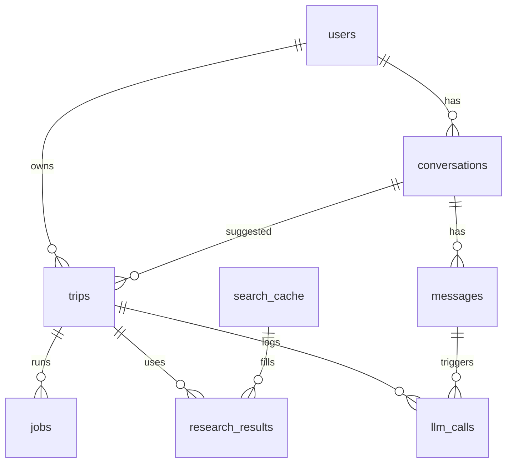

# AI trip planner design

Date: 2026-11-16. Status: approved 2026-11-16.

## Intent

A public website for people planning a holiday. A visitor who does not know where to go yet can chat to get destination ideas. A visitor who does describes the trip they want (dates, budget, group, travel style, destination, transport), the system researches it on the web, writes a day-by-day plan, lets the visitor ask about or change the plan in a chat, and exports the plan to `.xlsx` in the layout of `data/trip-template.xlsx`.

This document covers the core logic (backend), the database, and the requirement gaps that a production deployment needs. The frontend is described only as far as the backend has to serve it.

## Goals

- Help a visitor with no destination in mind find one: the chat suggests destinations that fit their dates, budget, group and style, and any suggestion can start a plan.
- Turn a filled form into a dated, budgeted, day-by-day plan in one background run.
- Advise on transport: when the visitor does not pick a mode, the plan compares the options and picks one; when they do, the plan stays within their choice.
- Ground the plan in research: weather, accommodation, transport to and at the destination, things to do and food. Every price says whether it is an estimate or taken from a source, and links to the source when there is one.
- Let the visitor chat about the plan: ask questions, ask for suggestions, and change it. Every change overwrites the trip's plan; no history is kept.
- Export the plan to `.xlsx` that opens in Excel with the template's formulas working.
- Run on free OpenRouter models without falling over when one model is rate-limited, slow, or returns broken JSON.

## Non-goals (v1)

- Login, passwords, or access control. A user is a unique name only (see users below). Real login is added later without changing the trip tables.
- Booking, payment, or live availability. The plan is advice, not a reservation.
- Live hotel or flight prices from booking APIs. Prices come from web search and are labelled.
- Qdrant or any vector store. Nothing in v1 needs semantic retrieval; the plan and its sources fit in the prompt.
- More than two currencies in one plan. A plan uses VND, plus the destination's local currency for trips outside Vietnam.
- Running more than one API instance. The rate limiter is in-process (see limits).

## Anti-goals

The build fails even if it works technically when:

- A plan shows invented prices, hotels, or links as if they were real.
- A plan goes over budget without saying so.
- A chat edit silently drops or rewrites parts of the plan the visitor did not ask to change.
- One visitor can use up the day's free LLM or Tavily quota for everyone.
- The exported `.xlsx` has broken formulas or loses the template's structure.

## Constraints

- Backend: Python 3.12+, FastAPI, the existing `src/` layout and LLM providers (`src/models/provider.py`).
- Database: Postgres 17 (`postgres:17-alpine`). Schema changes and SQL live in `sql/`.
- LLM: free OpenRouter models listed by `scripts/sync_models.sh` into `src/core/constants.py`. Free models have small rate limits and uneven JSON and tool-call quality (exact limits unverified, see https://openrouter.ai/docs/api-reference/limits).
- Web search: Tavily (`src/tools/implementations/web_search_tool.py`).
- Secrets come from `.env` only.
- Excel template: Vietnamese labels, three sheets with formulas (Itinerary rows 3 to 82, Checklist rows 2 to 31, Summary rows 3 to 102), a currency table at `Itinerary!J3:K6`, headcount at `Itinerary!K8`, defined name `Currencies`, and six fixed cost categories on Summary (`Đi lại`, `Lưu trú`, `Ăn uống`, `Mua sắm`, `Dịch vụ`, `Thăm quan`).

## Approaches

Three ways were considered for the core flow.

| Approach | Plan creation | Chat edits | Trade-off |
|---|---|---|---|
| 1. Fixed pipeline in code (chosen) | Code runs fixed steps: validate, research in parallel, LLM writes plan JSON, code validates, save | LLM returns a structured edit; code validates, applies, overwrites the plan | Fewest LLM calls, each schema-checked with one repair retry; every step testable with a fake LLM |
| 2. Orchestrator routes to agents | `OrchestratorAgent` picks research, planner, budget agents at run time | Routed to answer, edit, research agents | Reuses the most code, but about twice the LLM calls and routing JSON from weak models fails more often |
| 3. One agent with tools | One `Agent` loops with search and save tools | Same agent edits through tools | Least code, least control; free models drop or garble tool calls in long loops |

The user picked approach 1. The chat step borrows one piece of approach 2: `OrchestratorAgent` classifies each chat message (question, edit, new research, general advice), because that decision is small and the routing code and its parse-and-repair pattern already exist.

## Decisions made with the user

- Visitors do not log in. There is a `users` table with a unique name, compared ignoring case and surrounding spaces. Anyone who types a name acts as that user for now; access control is deferred.
- Core logic first; the login logic is left for later.
- Approach 1, fixed pipeline.
- Trips can go anywhere; Vietnam is the default. A domestic trip uses VND only. A trip outside Vietnam uses two currencies: VND (home, budget) and the destination's local currency.
- The UI is in English by default, with Vietnamese as a second UI language. The LLM replies in the language the visitor writes in (English or Vietnamese).
- A conversation is not tied to one task or one trip: in the same chat the visitor can ask about or edit any of their trips, or look for a new destination. Destination ideas come as cards; each card's "Plan this trip" fills the trip form. The form links to a chat ("Not sure where? Get ideas") with what the visitor already entered.
- Transport modes are optional in the form. Empty means the system suggests.
- Free models only. When the free quota (LLM or search) runs out, the site says to try again tomorrow; there is no paid fallback.

## Calls made by the designer

Each of these is a proposal the user can overrule.

- Plan generation runs as a background job queued in a Postgres table, picked up by a worker process with `SELECT ... FOR UPDATE SKIP LOCKED`. No Redis. The frontend polls the trip for progress.
- A trip has one plan. Every change overwrites it; old plans are not kept.
- The plan is stored as one validated JSONB document on the trip, not as rows per item. Plans are small (tens of items) and are always read and written whole.
- Weather comes from Open-Meteo (free, no key, https://open-meteo.com/en/docs), not from Tavily. Within its forecast window (16 days) it gives a forecast; further out, the same dates of the previous year from its archive API are used as a typical-weather guide and labelled as such.
- The destination is picked from a place search in the form (Open-Meteo geocoding, https://open-meteo.com/en/docs/geocoding-api, no key), not typed as free text. That gives coordinates for weather and a country code; the country code decides the local currency through a static country-to-currency map in `src/core/constants.py`. Vietnam (`VN`) means VND only.
- Exchange rates come from the ExchangeRate-API open endpoint (`https://open.er-api.com/v6/latest/VND`, no key, daily rates). VND coverage and its terms of use are unverified; check before building. Rates are cached for 24 hours, and the plan stores the rate it used, so its numbers do not move until the plan is rewritten.
- Tavily search results are cached in Postgres by normalized query for 24 hours, so repeated trips to the same place do not spend quota.
- LLM calls go through a model router with an ordered fallback list from config. A model that returns 429, 5xx, a timeout, or JSON that still fails after one repair is skipped for that call.
- SQL lives in `sql/`: numbered migrations in `sql/migrations/`, named queries in `sql/queries/<area>.sql` (blocks headed `-- name: <query_name>`), loaded by the repositories. This is the reading of "run migrations and sql command in `/sql`".
- Database access uses psycopg 3 with a connection pool, plain SQL, no ORM.
- Unused leftovers from the template project (Vietnamobile prompts, `otp_tool`, `chart_tool`, Bedrock RAG in `src/knowledge/`, `src/memory/` stubs) are left in place and not loaded by the new code. Removing them is a separate decision.

## Project structure

Backend, extending the existing `src/` layout. New folders are marked `new`.

```
src/
  api/
    main.py                 app factory, routers, CORS, error handlers, request id
    deps.py                 new: db pool, services, rate limiter wiring
    errors.py               new: domain exceptions -> HTTP status and body
    schemas/                new: request and response models per route
    routes/
      health.py             /health (liveness), /ready (db ping)
      users.py              new: claim a name, look up a user
      places.py             new: destination search for the form (proxies geocoding, cached)
      trips.py              new: create, get, list by user, delete, retry
      chat.py               replaces the current generic chat: conversations and messages, SSE stream
      exports.py            new: download .xlsx of the plan
  core/
    config.py               all settings from .env, checked at startup
    constants.py            existing ModelId (synced) plus trip enums
    logger.py               JSON logs with request_id, trip_id, job_id
    exceptions.py           domain exceptions (NotFound, Conflict, QuotaExceeded, LLMUnavailable, ...)
    prompts.py              existing prompts plus planner, editor, answer prompts
  db/                       new
    pool.py                 psycopg pool, transaction helper
    queries.py              loads named queries from sql/queries
    repositories/           users, conversations, trips, messages, jobs, research, llm_calls
  domain/                   new: pure code, no I/O
    trip_request.py         TripRequest model and its rules
    plan.py                 Plan, Day, PlanItem, Accommodation, ChecklistItem, Weather
    plan_edit.py            PlanEdit operations and apply(plan, edit) -> plan
    plan_rules.py           checks a plan against its request (dates, times, budget, sources)
    budget.py               totals per category and currency, converted to VND, over-budget amount
    currency.py             country -> currency map lookup, Money type, conversion with a stored rate
  research/                 new
    places.py               Open-Meteo geocoding client: name -> place, coordinates, country code
    weather.py              Open-Meteo forecast and archive client
    exchange_rates.py       VND rate for one local currency, cached 24 h
    web_research.py         Tavily query builders per kind, result trimming
    research_service.py     runs all research in parallel, uses the cache, tolerates partial failure
  planning/                 new
    plan_generator.py       research + request -> Plan via LLM, parse and repair, assigns item ids
    plan_editor.py          message + plan -> PlanEdit via LLM, parse and repair
    llm_json.py             shared "call, parse JSON, validate, repair once" helper (generalizes routing_parser)
  chat/                     new
    chat_service.py         save message, classify intent, run handler, stream reply
    handlers.py             answer, edit, research, general advice
  discovery/                new
    discovery_service.py    one discovery turn: decide (ask, suggest, answer), search, build cards
  export/                   new
    xlsx_exporter.py        fills the template for a trip's plan
  jobs/                     new
    worker.py               poll loop, lease, retry with backoff, stale lease recovery, graceful stop
    generate_plan.py        the plan generation job, stage by stage
    cleanup.py              deletes expired trips daily
  models/
    model_router.py         fills the existing stub: fallback chain, logs every call to llm_calls
    provider.py, base.py, llm_factory.py  existing
  orchestration/            existing; OrchestratorAgent used by chat_service
  tools/                    existing; web_search_tool used by research
sql/
  migrations/0001_init.sql
  queries/users.sql, conversations.sql, trips.sql, messages.sql, jobs.sql, research.sql, llm_calls.sql
scripts/
  sync_models.sh            existing (path bug fixed, see below)
  migrate.py                new: applies sql/migrations in order, records them in schema_migrations
tests/
  unit/                     domain, planning with a fake LLM, exporter
  integration/              repositories and API against a real Postgres
web/                        new: React + TypeScript (Vite)
  src/pages/                NamePage, HomePage (trips + conversations), ChatPage, NewTripPage, TripPage
  src/components/           TripForm, PlanView (by day), TransportOptions, ChatPanel, SuggestionCard, ExportButton
  src/api/                  typed client for the routes below
  src/i18n/                 en.json (default) and vi.json UI strings, a small lookup hook, choice kept in localStorage
docker-compose.yml          postgres:17-alpine, api, worker, web
.env.example                every setting, no values
pyproject.toml              dependencies and tool config
```

Dependency rule: `domain` imports nothing from the project. `planning`, `research`, `export` import `domain`. `chat` and `jobs` import those plus `db`. `api` imports services only, never SQL.

Dependencies to add (there is no dependency file today): `fastapi`, `uvicorn`, `pydantic`, `python-dotenv`, `openai`, `openrouter` (already imported by `provider.py`), `tavily-python`, `httpx`, `psycopg[binary,pool]`, `openpyxl`, `boto3` (already imported), and `pytest` for tests.

## Data flow

### Creating a trip

1. `POST /trips` takes a destination chosen from `GET /places` (name, country code, coordinates) and the UI language, checks the request (rules below), checks the global quota state, checks the user's daily trip cap, inserts the trip with status `queued` and a `generate_plan` job in one transaction, returns `202` with the trip id.
2. The worker leases the job and sets the trip status to `researching`.
3. `research_service` runs in parallel (thread pool): the VND exchange rate for the local currency when the destination is outside Vietnam (the job fails if no rate can be found, since prices cannot be compared to the budget without it); weather for each trip date; Tavily for accommodation, getting there from the origin (across all sensible modes when the visitor picked none, otherwise only the picked ones), local transport, things to do matching the travel styles, food: 5 searches, one per kind, in one language (Vietnamese for Vietnam destinations, English otherwise). Each search goes through the cache. A failed search is recorded and skipped; the plan continues without it and gets a warning. If every web search fails, the job fails.
4. Status `planning`. `plan_generator` sends the request plus trimmed research (top results per kind, text cut to a fixed length, each with a numeric source id) and asks for Plan JSON. The output is parsed and validated; on failure the model sees its answer and the errors once; if it still fails the router tries the next model.
5. `plan_rules` checks the plan in code: there are 2 to 3 transport options for the outbound and the return leg with exactly one chosen per leg, and when the visitor picked modes every chosen option uses one of them; every date in the trip has a day, items are in the trip dates, times are in order within a day, categories are valid, source ids exist in the research set (unknown ones are removed and the price becomes an estimate). If the total is over budget, one repair round asks the model to cut cost; if it is still over, the plan is kept with an `over_budget` warning.

Call budget per job: at most 6 LLM calls in total, counting repairs, model fallbacks and job retries (`jobs.llm_calls_used`). When it is used up the job stops and the trip is `failed` with reason `llm_budget_exceeded`. In the normal case a new trip costs 1 LLM call (3 at most when the output needs a repair and the plan is over budget) and 5 Tavily calls, fewer when cached, plus free Open-Meteo and exchange-rate calls.
6. Code assigns stable item ids, writes the plan and its totals to the trip, bumps `plan_revision`, status `ready`. Job `succeeded`.
7. On a final failure the trip status is `failed` with a short reason; `POST /trips/{id}/retry` queues a new job.

The frontend polls `GET /trips/{id}` every 2 seconds while the status is `queued`, `researching`, or `planning`.

### Chatting

`POST /conversations` `{user_id, draft?}` starts a conversation (optionally with the form fields already entered as a draft). `POST /conversations/{id}/messages` with `{content, trip_id?, plan_revision?}` returns a server-sent event stream. `trip_id` is the trip open on screen, if any; it must belong to the conversation's user (else `404`).

1. Save the user message.
2. Classify it with `OrchestratorAgent` against a fixed catalog: `plan_answer` (questions about a plan), `plan_editor` (change the plan), `trip_research` (needs new information, such as "cheaper hotels near the beach"), `travel_advice` (general advice not tied to a plan), `discover` (find a destination for a new trip). `needs_clarification` sends the clarification text back as the reply. `fallback` is treated as `plan_answer` when `trip_id` is set, else `travel_advice`.
3. Run the handler. The LLM context is a short summary of every trip of the user (destination, dates, status), the request and a compact form of the plan (items with ids) of the trip in `trip_id`, its research summaries, and the last 10 messages of the conversation.
   - `plan_answer` and `travel_advice` stream text.
   - `plan_editor` needs `trip_id` and `plan_revision`; without them the reply asks the visitor to open the trip they want to change. Edits only ever apply to the trip in `trip_id`.
   - `plan_editor` asks for a `PlanEdit`: a list of operations (`add_item`, `update_item`, `remove_item`, `move_item`, `set_accommodation`, `choose_transport_option`, `add_transport_option`, `replace_day` with new items for one date, `update_checklist`) plus a short explanation. Code checks that referenced ids exist and dates are in the trip, applies the edit to a copy, runs `plan_rules`, overwrites the plan, and streams the explanation and a list of what changed.
   - `trip_research` does not rerun the plan flow. The router's step `task` text (for example "train or bus Hanoi to Da Nang, 4 people, 20 Dec") is the search query: 1 to 2 Tavily calls (cached), then 1 LLM call to answer from the results, saved as `research_results` with kind `chat`. If the answer suggests a change, it is offered as text and only applied when the visitor confirms in a later message. Cost: 2 LLM calls and 1 to 2 Tavily calls; a question about the existing plan costs 2 LLM calls and no search.
   - `discover` runs one discovery turn (below).
4. Save the assistant message with its intent.

Chat replies are in the language of the visitor's message (English or Vietnamese), whatever the UI language. Plan text stays in the trip's language unless the visitor asks to change it, which is an `update_request` that sets `language`.

A change to the trip request itself (dates, number of travelers, origin, language) is an edit operation `update_request`; it queues a new `generate_plan` job carrying the new request (`jobs.request`) that keeps the current plan as a starting point; the new request is written to the trip together with the new plan, so the trip never pairs a new request with an old plan. A new destination is a new trip; the reply says so. While that job runs, the trip status shows the job stage, the current plan stays viewable and exportable, questions are answered, and edits get `409` until the new plan lands.

Concurrent edits: the client sends the `plan_revision` it is looking at. The plan is written with `UPDATE ... SET plan_revision = plan_revision + 1 WHERE id = $1 AND plan_revision = $2`; zero rows updated means the plan has moved on, the edit is rejected with `409` and the frontend reloads.

### Discovery turn

For a visitor who does not know where to go. It runs inside any conversation when the router picks `discover`.

1. The user message is already saved.
2. One LLM call returns a `DiscoveryTurn`: `action` (`ask` a follow-up question, `suggest` destinations, `answer` a general travel question), the reply text, an updated `request_draft` (any of origin, dates or month, length, travelers, group, styles, budget per person, transport modes picked up from the chat), and for `suggest` up to 3 search queries.
3. For `suggest`: run those searches (Tavily, cached), then a second LLM call returns 3 destination cards. Each card: place name, country code, why it fits, suggested length in days, estimated cost per person in VND (always marked estimate), best months, highlights, source ids. Code checks the schema and drops cards whose country is not in the currency map.
4. Save the assistant message with the cards (`suggestions`) and save `request_draft` on the conversation.
5. "Plan this trip" on a card: the frontend resolves the place name with `GET /places`, opens the trip form filled from `request_draft` plus the place, and the visitor reviews and submits. The new trip records the conversation it came from.

Cost per turn, on top of the classify call: 1 LLM call for `ask` and `answer`, 2 LLM calls and up to 3 Tavily calls for `suggest`. The AI asks for missing basics (rough dates, budget, origin) before suggesting, at most twice, then suggests with what it has and states its assumptions. Every message counts toward the same chat limits.

### Exporting

`GET /trips/{id}/export.xlsx` builds the file in memory from the template and streams it. Exports are not stored.

## Plan document (JSONB)

```json
{
  "title": "Da Lat 4 ngày cho nhóm bạn",
  "summary": "...",
  "currencies": {"home": "VND", "local": "THB", "local_to_home_rate": 720.5, "rate_date": "2026-11-16"},
  "days": [
    {
      "date": "2026-12-20",
      "theme": "...",
      "weather": {"summary": "...", "temp_min_c": 14, "temp_max_c": 23, "precip_mm": 2, "basis": "forecast"},
      "items": [
        {
          "id": "it_3",
          "start_time": "08:00",
          "end_time": "09:30",
          "title": "...",
          "description": "...",
          "location": "...",
          "category": "transport",
          "transport_mode": "bus",
          "price_per_person": 350,
          "price_currency": "THB",
          "price_basis": "source",
          "source_id": 7,
          "status": "planned",
          "note": "..."
        }
      ]
    }
  ],
  "transport_options": [
    {"id": "tr_1", "leg": "outbound", "mode": "train", "summary": "SE1 Hanoi to Da Nang", "depart": "2026-12-19T19:00", "duration_minutes": 960, "price_per_person": 900000, "price_currency": "VND", "price_basis": "source", "source_id": 3, "pros": "...", "cons": "...", "chosen": true},
    {"id": "tr_2", "leg": "outbound", "mode": "flight", "summary": "...", "depart": null, "duration_minutes": 80, "price_per_person": 1500000, "price_currency": "VND", "price_basis": "estimate", "source_id": null, "pros": "...", "cons": "...", "chosen": false}
  ],
  "accommodation": [
    {"id": "ac_1", "name": "...", "area": "...", "check_in": "2026-12-20", "check_out": "2026-12-24", "price_per_night": 1800, "price_currency": "THB", "rooms": 2, "price_basis": "estimate", "source_id": null, "chosen": true}
  ],
  "checklist": [
    {"id": "ck_1", "label": "...", "category": "service", "price_per_person": 0, "price_currency": "VND", "done": false}
  ],
  "warnings": [{"code": "over_budget", "message": "..."}]
}
```

- `currencies.local` and the rate are null for a trip inside Vietnam; then every `price_currency` is `VND`. For a trip abroad every price is in `VND` or the local currency, whichever the source quoted (flights booked from Vietnam are usually VND, things on the ground local). Prices are never converted inside the document, so a `source` price stays exactly as quoted; totals and the budget check convert with the stored rate in code.
- `transport_options` covers the `outbound` and `return` legs (2 to 3 options each, one `chosen`) and optionally `local` (getting around at the destination). The chosen outbound and return options also appear as `transport` items on the first and last day, linked by `option_id`, so the itinerary and the export include them. Changing the chosen option updates those items in the same edit.
- `category` is one of `transport`, `accommodation`, `food`, `shopping`, `service`, `sightseeing`, which map one-to-one to the template's `Đi lại`, `Lưu trú`, `Ăn uống`, `Mua sắm`, `Dịch vụ`, `Thăm quan`.
- `price_basis` is `source` (a figure found in the cited source) or `estimate`. The UI and the export mark estimates.
- `weather.basis` is `forecast` or `typical` (last year's same dates).
- `status` is `planned`, `booked`, or `paid`.
- `source_id` points to a row in `research_results` for this trip.
- Ids are assigned by code, never by the LLM, and stay stable across edits.

## Database

Postgres 17. `gen_random_uuid()` is built in from Postgres 13, so no extension is needed. All timestamps are `timestamptz`. Money is `numeric(14,2)`.



### users

| Column | Type | Notes |
|---|---|---|
| id | uuid pk | default `gen_random_uuid()` |
| name | text not null | 1 to 50 characters after trimming (check) |
| name_key | text generated always as `lower(btrim(name))` stored | unique; this is the duplicate-name rule |
| created_at | timestamptz not null default now() | |
| last_seen_at | timestamptz | updated on use, for retention |

Later login adds columns here (for example a secret key hash); no other table changes.

### trips

| Column | Type | Notes |
|---|---|---|
| id | uuid pk | |
| user_id | uuid not null fk users on delete cascade | index |
| destination_name | text not null | display name from the place search, 1 to 200 chars |
| destination_country | char(2) not null | ISO 3166-1 alpha-2 from geocoding; `VN` means domestic |
| destination_lat, destination_lon | double precision not null | for weather |
| origin | text not null | where the group starts from |
| start_date, end_date | date not null | check `end_date >= start_date`, check length at most 30 days |
| travelers | int not null | check 1 to 50 |
| group_type | text not null | check in (`solo`, `couple`, `family`, `friends`, `colleagues`) |
| travel_styles | text[] not null | each in (`relax`, `adventure`, `culture`, `food`, `nature`, `nightlife`, `shopping`, `luxury`, `budget`), at least 1 |
| transport_modes | text[] not null default '{}' | each in (`flight`, `train`, `bus`, `car`, `motorbike`, `boat`); empty means the system suggests |
| conversation_id | uuid fk conversations on delete set null | the conversation the trip came from (a "Plan this trip" card), if any |
| budget_amount | numeric(14,2) not null | in VND, check > 0 |
| budget_scope | text not null | `per_person` or `total` |
| local_currency | char(3) | ISO 4217, set from the country map when `destination_country <> 'VN'`, null otherwise; check that it is null exactly when the country is `VN` |
| language | text not null default `en` | `en` or `vi`; plan text language, from the UI language at creation |
| notes | text | free text from the form, max 2000 chars |
| status | text not null | `queued`, `researching`, `planning`, `ready`, `failed` |
| failure_reason | text | set when `failed` |
| plan | jsonb | the plan document, null until the first plan; overwritten on every edit or re-plan; check `jsonb_typeof(plan) = 'object'` |
| total_cost_vnd | numeric(14,2) | computed by code with the plan's stored rate, stored for lists |
| over_budget | boolean | |
| model_id | text | model that last wrote the plan |
| plan_revision | int not null default 0 | bumped on every overwrite; edits apply only when it equals the client's value |
| created_at, updated_at | timestamptz | |
| expires_at | timestamptz not null | `updated_at` + retention, moved forward on every update or chat message; index for cleanup |

`plan`, `total_cost_vnd` and `over_budget` are all set or all null (check).

Enum-like columns use `text` plus `check` instead of Postgres enum types, so adding a value is a one-line migration.

### conversations

| Column | Type | Notes |
|---|---|---|
| id | uuid pk | |
| user_id | uuid not null fk users on delete cascade | index |
| title | text | first user message, cut to 80 chars |
| request_draft | jsonb | trip fields gathered so far when the chat is collecting a new trip |
| created_at, updated_at | timestamptz | |

A conversation is not tied to one task or one trip: any conversation can read every trip of its user. It is deleted by its user (`DELETE /conversations/{id}`) or together with its user.

### messages

| Column | Type | Notes |
|---|---|---|
| id | uuid pk | |
| conversation_id | uuid not null fk conversations on delete cascade | index (conversation_id, created_at) |
| role | text not null | `user`, `assistant` |
| content | text not null | user messages max 4000 chars |
| intent | text | assistant rows: `plan_answer`, `plan_editor`, `trip_research`, `travel_advice`, `clarification`, or for a discovery turn `ask`, `suggest`, `answer` |
| suggestions | jsonb | `suggest` replies: the destination cards |
| created_at | timestamptz | |

### jobs

| Column | Type | Notes |
|---|---|---|
| id | uuid pk | |
| trip_id | uuid not null fk trips on delete cascade | |
| kind | text not null | `generate_plan` (v1 only kind) |
| status | text not null | `queued`, `running`, `succeeded`, `failed` |
| stage | text | `researching`, `planning`, `validating` for progress |
| attempts | int not null default 0 | |
| max_attempts | int not null default 3 | |
| llm_calls_used | int not null default 0 | counts across attempts; the job stops at the configured cap (default 6) |
| run_after | timestamptz not null default now() | backoff |
| leased_until | timestamptz | lease; an expired lease is picked up again |
| request | jsonb | re-plans after `update_request`: the new request, written to the trip with the new plan; null otherwise |
| last_error | text | |
| created_at, finished_at | timestamptz | |

Partial unique index on `(trip_id) where status in ('queued','running')`: one active job per trip. Index on `(status, run_after)` for the poll.

### search_cache

| Column | Type | Notes |
|---|---|---|
| key | text pk | sha256 of provider + normalized query + parameters |
| provider | text not null | `tavily`, `open_meteo`, `open_meteo_geocoding`, `exchange_rate` |
| query | text not null | |
| payload | jsonb not null | raw response, trimmed |
| created_at | timestamptz | |
| expires_at | timestamptz not null | 24 h for Tavily and exchange rates, 6 h for forecasts, 30 days for archive weather and geocoding |

### research_results

| Column | Type | Notes |
|---|---|---|
| id | bigint identity pk | this is the `source_id` used in plans |
| trip_id | uuid fk trips on delete cascade | |
| kind | text not null | `weather`, `accommodation`, `transport`, `local_transport`, `activities`, `food`, `chat` |
| conversation_id | uuid fk conversations on delete cascade | set for discovery-turn searches (then `trip_id` is null; check that one of the two is set) |
| cache_key | text fk search_cache on delete set null | |
| title | text | |
| url | text | |
| snippet | text | trimmed text the LLM saw |
| created_at | timestamptz | |

### llm_calls

| Column | Type | Notes |
|---|---|---|
| id | bigint identity pk | |
| trip_id | uuid fk trips on delete set null | |
| conversation_id | uuid fk conversations on delete set null | |
| message_id | uuid fk messages on delete set null | chat calls: the user message that triggered them (saved before any call, unlike the reply); index |
| purpose | text not null | `generate`, `repair`, `classify`, `edit`, `answer`, `discover`, `suggest` |
| model_id | text not null | |
| input_tokens, output_tokens | int | |
| latency_ms | int | |
| outcome | text not null | `ok`, `rate_limited`, `quota_exhausted`, `timeout`, `provider_error`, `invalid_output` |
| error | text | |
| created_at | timestamptz | index for daily usage queries |

Used for cost and quota tracking, model health, and debugging. Prompt and response text are not stored here (privacy); they go to debug logs only when debug logging is on.

### quota_blocks

| Column | Type | Notes |
|---|---|---|
| service | text pk | `openrouter`, `tavily` |
| blocked_until | timestamptz not null | next reset time |
| reason | text | the provider's error text, trimmed |

Shared by the API and the worker so both see the block at once.

### schema_migrations

`version text pk, applied_at timestamptz`, written by `scripts/migrate.py`.

## API

| Method and path | Purpose | Main errors |
|---|---|---|
| `POST /users` `{name}` | Claim a name, or return the existing user for that name | 422 invalid name |
| `GET /users/{id}` | User and trip count | 404 |
| `GET /users/{id}/trips` | Trips, newest first, paged | 404 |
| `GET /users/{id}/conversations` | Conversations, newest first | 404 |
| `POST /conversations` `{user_id, draft?}` | Start a conversation | 422, 429 |
| `GET /conversations/{id}` | Conversation, draft, messages (paged) with cards | 404 |
| `PATCH /conversations/{id}` `{title}` | Rename (1 to 80 characters after trim, NFC); `updated_at` does not change | 404, 422 |
| `DELETE /conversations/{id}` | Delete the conversation, its messages and its research rows; trips made from it stay with `conversation_id` null | 404 |
| `POST /conversations/{id}/messages` `{content, trip_id?, plan_revision?}` | Send a message, SSE reply (text, then a plan change or cards) | 404 trip not the user's, 409 plan changed, 409 trip not ready, 429, 429 `quota_exhausted` |
| `GET /places?q=` | Destination search for the form (min 2 chars, max 10 results) | 422, 429 |
| `POST /trips` | Create trip and queue generation (`conversation_id` optional) | 422, 429 daily cap, 429 `quota_exhausted` |
| `GET /trips/{id}` | Trip, status, stage, current plan | 404 |
| `POST /trips/{id}/retry` | Queue generation again after `failed` | 409 if a job is active |
| `DELETE /trips/{id}` | Delete trip and everything under it | 404 |
| `GET /trips/{id}/export.xlsx` | Download the current plan | 404, 409 not ready |
| `GET /health`, `GET /ready` | Liveness, readiness (db) | 503 |

Errors use one body shape: `{"error": {"code": "...", "message": "..."}}`. Raw exception text is never returned to the client (the current `src/api/routes/chat.py` does that).

## Validation rules for a trip request

- `start_date` is today or later (server date, Asia/Ho_Chi_Minh); `end_date >= start_date`; at most 30 days.
- `travelers` 1 to 50; `budget_amount` > 0 (VND).
- The destination must come from the place search (name, country code, coordinates all present); the country must be in the currency map.
- `language` is `en` or `vi`.
- Text fields trimmed, length-limited, control characters removed.
- At least one travel style. Transport modes may be empty.

## Excel export

`xlsx_exporter` opens the template with openpyxl, fills it, and returns bytes. Formulas are kept as written; Excel recalculates on open. Template labels stay Vietnamese; the content (titles, notes) is in the trip's language.

The template's `Checklist!C2` ("Di chuyển/Đi lại") is `=SUM(Itinerary!E3:E82)`, so column E of Itinerary must hold transport prices only, or other costs would be counted as transport. The mapping follows from that, so the template's `Tổng chi phí dự kiến` (`Checklist!L10`) equals the plan's `total_cost`:

- Itinerary: `A1` = `"<destination> TRIP"`. One row per plan item from row 3, ordered by date and time: A date, B time range, C title plus location, D transport mode, E price per person only when the item's category is `transport` (empty otherwise; non-transport prices go in G as text), G note (plus "estimate" for estimates), H status. `J3` = `VND`, `K3` = 1, `K8` = travelers. For a trip abroad `J4` = local currency and `K4` = the plan's rate (VND per 1 unit); the template's E2 header then reads `Giá(<local>/người)`, so column E holds local-currency transport prices only. Transport priced in VND on a trip abroad (an international flight) goes to Checklist as its own row with unit `VND`, and its Itinerary row shows the price in the note. Accommodation costs never go in column E; a check-in item may appear as a row with its price only in the note. If there are more than 80 items, rows after 82 get the column F formula for their row number and the exporter rewrites `Checklist!C2` to cover the last row.
- Checklist: trip info in column L (`L2` destination, `L3` origin, `L4` dates, `L5` nights, `L7` group, `L8` styles, `L9` budget per person, `L12` chosen accommodation). Row 2 (transport) is left as the template has it. From row 3, one row per remaining category and currency with a non-zero total, per person: `Lưu trú` (chosen accommodation), `Ăn uống`, `Thăm quan`, `Mua sắm`, `Dịch vụ` (sums of items in that category), then each checklist item with a price. Columns: A `☐`, B label, C price per person, E currency (`VND` or the local one; the template's F and G columns convert to VND with the `J3:K6` table). Checklist items with no price go in the same list with C empty. If rows run past 31, the remaining checklist items are merged into one "Khác" row.
- Costs shared by the whole group (a hired car, a villa) are stored and exported per person (total divided by travelers), so `C x travelers` gives the total.
- Summary: left empty for the traveler to record actual spending during the trip.
- A test opens the exported file and checks the cells above, the defined name `Currencies`, and the data validations.

## LLM use

- `model_router` takes an ordered list of model ids from config per purpose (`PLANNER_MODELS`, `CHAT_MODELS`, `CLASSIFIER_MODELS`), drops ids no longer in `ModelId`, and tries them in order. Timeouts per call: 90 s for planning, 30 s for chat.
- All structured outputs go through `llm_json`: extract the first JSON object, validate with Pydantic, run semantic checks, one repair round with the errors, then the next model. This is the pattern in `src/orchestration/routing_parser.py`, made generic.
- Research text from the web is wrapped in tags and the prompt says it is data, never instructions. Because every output is schema-checked and applied by code, injected text can at worst produce a bad plan, not run actions.
- Language: the planner prompt states the trip's language; chat prompts tell the model to answer in the language of the latest user message. Tavily queries are written in Vietnamese for Vietnam destinations (local sources are in Vietnamese) and in English otherwise, one query per research kind.
- Prompts live in `src/core/prompts.py` next to the existing ones.

## Free quota running out

Free models only; there is no paid fallback.

- The router tells the per-minute rate limit (retry the next model) apart from the daily free cap (OpenRouter's 429 whose message names the daily free-model limit; exact wording unverified, match it in one place with a test). Tavily's monthly limit is detected the same way.
- On a daily or monthly cap, the router writes `quota_blocks` (`blocked_until` = next reset; OpenRouter is assumed to reset at 00:00 UTC, unverified, so it is a config value) and raises `QuotaExhausted`.
- While a block is active: `POST /trips`, `POST /trips/{id}/retry` and chat messages return `429` with code `quota_exhausted` and the reset time; the UI shows "We've hit today's free AI limit. Please try again tomorrow." (Vietnamese text in `vi.json`). Viewing trips and exports keeps working.
- A job hit by `QuotaExhausted` stops without using its remaining attempts; the trip is `failed` with reason `quota_exhausted`, and the trip page shows the same message with a retry button that works after the reset.
- The configured global daily ceilings in limits below stop usage a little before the provider's cap, so the block is usually reached cleanly rather than mid-job.

## Limits and abuse protection

- Per IP: 30 API requests per minute, 10 chat messages per minute (in-process token bucket; one API instance).
- Per IP per day: 10 new trips, 200 chat messages (in-process counters, reset daily, lost on restart). Names have no password, so a visitor can switch names to dodge the per-name caps; this cap is what stops one visitor from draining the shared quota.
- Per user name: 5 new trips per day, 100 chat messages per day (counted in the database).
- The client IP is taken from `X-Forwarded-For` only when `TRUST_PROXY_HEADERS` is on (behind a known proxy); otherwise from the socket.
- Global: when today's `llm_calls` or Tavily count reaches a configured ceiling, new trips get `429` with a clear message; chat keeps working until a second, higher ceiling.
- Request body size capped at 64 KB.

All numbers are defaults in config, not measured; tune after real use.

## Retention and privacy

- Trips expire 30 days after their last update (config). The daily cleanup job deletes expired trips; cascades remove research rows and jobs. Conversations and messages stay until the visitor deletes the conversation or their user is deleted.
- Users with no trips and no activity for 90 days are deleted with their conversations, freeing the name.
- `search_cache` rows are deleted after `expires_at`.
- No IP addresses are stored in the database; they exist only in the in-process limiter and in access logs.

## Observability

- JSON logs with `request_id`, `trip_id`, `job_id`, `model_id`.
- `llm_calls` gives tokens, latency and failures per model per day, per trip and per chat message.
- `/ready` checks the database; the worker logs a heartbeat each minute and its job outcomes.

## Testing

- Unit: `domain` rules and `apply(plan, edit)`; `llm_json` with canned good, broken and repairable outputs; `plan_generator` and `plan_editor` with a fake LLM provider (injected the way `OrchestratorAgent` takes `llm=`); research service with fake clients including partial failure; exporter cell checks.
- Integration: repositories, migrations, the job lease (two workers, one job), plan revision conflict, cascade delete, against Postgres in docker compose.
- API: create trip to ready with fake LLM and search, chat edit overwrites the plan, export downloads.
- No test calls real OpenRouter, Tavily or Open-Meteo. A manual smoke script does, outside the test suite.

## Existing problems the build fixes

- `src/api/routes/chat.py:18` uses `model.NEMOTRON_3_NANO_30B_A3B`, which is not in `src/core/constants.py`, so the API fails at import. The route is replaced by the conversation chat.
- `scripts/sync_models.sh` passes `core/constants.py`, but the file is `src/core/constants.py`.
- `web_search_tool` describes itself as Vietnamobile search; its description is rewritten for travel.
- No dependency file, `.env.example`, migrations, tests or frontend exist yet.

## Requirements

The updated requirement list, including what this design adds, is in `REQUIREMENTS.md`.

## Left to the builder

- Exact prompt wording and the trimming length for research text.
- Tavily query templates per research kind and the number of results per kind.
- Frontend look and component details, within the four pages listed.
- Thread pool size for research and the worker poll interval.
- How the compact plan form for chat context is rendered, as long as item ids are visible.
